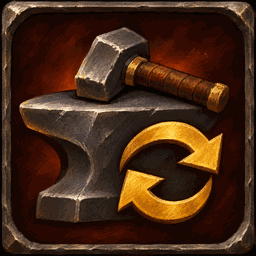

# Auto Repair

When you open a repair vendor, **Auto Repair** fixes your equipped gear and
repairable items in your bags. It uses your gold by default and shows what
you paid in chat.

**For WoW Retail and WoW Forever.** [Download Auto Repair](https://github.com/myzticdev/AutoRepairStuff/releases/latest)

## Install

1. On the [latest release](https://github.com/myzticdev/AutoRepairStuff/releases/latest) page, download the **AutoRepairStuff** ZIP under **Assets** and unzip it. If the release only offers **Source code (zip)**, download that and open the extracted folder to find the inner `AutoRepairStuff` folder.
2. Copy the `AutoRepairStuff` folder from the zip into your game's AddOns folder.

   | Game | AddOns folder |
   | --- | --- |
   | WoW Retail | `World of Warcraft/_retail_/Interface/AddOns/` |
   | WoW Forever | `World of Warcraft/_forever_/Interface/AddOns/` |

3. Launch the game and make sure **Auto Repair** is checked in the **AddOns** list on the character selection screen. If you're updating while logged in, replace the old addon folder and type `/reload` in chat.
4. Open a repair vendor with damaged gear. Keep the vendor window open until you see the green message showing the cost and whose gold paid for it.

## Settings

Open **Esc → Options → AddOns → Auto Repair**. Each character has their own settings.

| Setting | What it does |
| --- | --- |
| **Repair mode** | **Your gold** is the default. Choose **Guild gold when available** to use guild gold when your rank and allowance cover the bill, with your gold as the fallback. Choose **Off** to pause automatic repairs. |
| **Durability threshold** | **Any damage** repairs whenever there's a repair bill. Set it to **5%**, for example, to wait until at least one equipped item drops below 5%. Once a repair starts, the vendor fixes all eligible items, including gear in your bags. |
| **Hide repair message** | Hides the green message after a successful repair. You'll still get a warning if you're short on gold. |

## Troubleshooting

- **Auto Repair is missing from the AddOns list.** Open your installed `AutoRepairStuff` folder and check that `AutoRepairStuff.toc` is directly inside it.
- **I opened a vendor and nothing happened.** Make sure the vendor can repair gear, **Repair mode** is enabled, and your gear meets the durability threshold. Set the threshold to **Any damage** to test with lightly damaged gear.
- **My guild repair was declined.** Use the vendor's regular repair button, or choose **Your gold** and reopen the vendor.

Optional chat commands

| Command | What it does |
| --- | --- |
| `/autorepair` | Show your current repair mode. |
| `/autorepair personal` | Use your own gold. |
| `/autorepair guild` | Prefer guild gold when available. |
| `/autorepair off` | Pause automatic repairs. |

